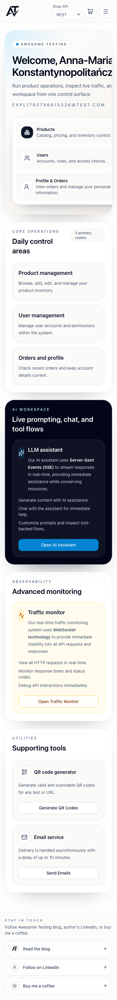
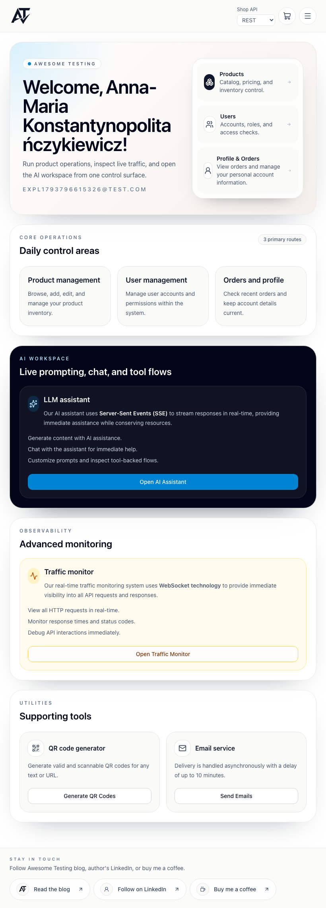

# BUG-001 [VISUAL] Home on mobile: a long user name pushes the hero card off screen and clips it

| | |
|---|---|
| Category | Visual |
| Severity / Priority | Major / P2 |
| Environment | Chromium, 393×852 mobile (also checked: OK on 820×1180 and 1920×1080) |
| Preconditions | Logged in as a user with first name `Anna-Maria Konstantynopolitańczykiewicz` |

**Steps to reproduce**
1. Register a user with the first name above (any valid other fields) and log in.
2. Open `/` on a 393 px wide viewport.

**Expected:** The welcome title wraps (or breaks the long word) inside the card; the email and the Products / Users / Profile & Orders quick links stay fully visible.

**Actual:** The title does not wrap the long word, the hero card grows wider than the viewport and is clipped on the right: the title ends at "Konstantynopolitańcz", and the email, the subtitle and the quick-link descriptions are cut ("View orders and manage your personal a…"). The elements `home-welcome-title`, `home-user-email`, `home-products-button`, `home-users-button`, `home-profile-button` extend past the right edge.

**Evidence:**

Tablet for comparison (correct):

**Notes:** Likely missing `overflow-wrap: anywhere` / `min-width: 0` on the hero grid column. Long names are realistic (double-barrelled surnames are accepted by registration).
