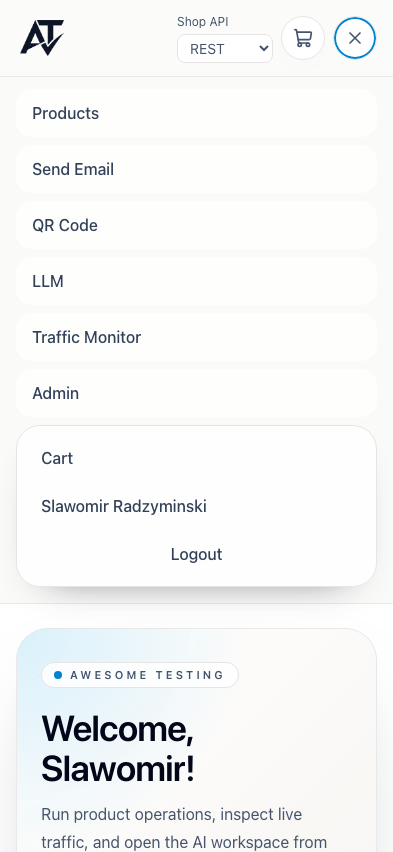

# BUG-004 [A11Y] Accessibility findings on Login, Register, Home and Header

| | |
|---|---|
| Category | Accessibility (WCAG 2.2 AA) |
| Severity / Priority | Minor / P4 |
| Environment | Chromium, all viewports (1920×1080, 820×1180, 393×852); frontend 3.9.1 |
| Preconditions | Logged out for Login/Register, logged in for Home/Header |

Each section below is one finding, grouped by screen.

## Header

### Cart icon link has no accessible name (WCAG 2.4.4, 4.1.2)

**Steps:** Tab to the cart icon or inspect the header accessibility tree.

**Expected:** Announced as "Cart" (`aria-label` or visually hidden text), with the item count when present.

**Actual:** `a[data-testid="desktop-cart-icon"]` contains only an SVG; the tree shows `link` with no name, a screen reader says just "link".

### Mobile menu toggle exposes no state and ignores Escape (WCAG 4.1.2, 2.1.1)

**Steps:** On a mobile viewport tap the hamburger (`mobile-menu-toggle`), inspect it, press Escape.

**Expected:** `aria-expanded="true"` and `aria-controls` pointing to the menu; name changes to "Close main menu" (the icon already changes to ×); Escape closes the menu and returns focus to the button.

**Actual:** No `aria-expanded` / `aria-controls`; the name stays "Open main menu" while open; Escape does nothing.

## Login

### Validation errors are not linked to their fields (WCAG 3.3.1, 1.3.1)

**Steps:** Click "Sign in" with empty fields, inspect the username and password inputs.

**Expected:** `aria-invalid="true"` and `aria-describedby` pointing to the message, so a screen reader reads "Username is required" on focus.

**Actual:** `login-username-error` and `login-password-error` are visual only; inputs have neither attribute.

### No `h1` (WCAG 1.3.1)

**Expected:** "Sign in to your account" is an `h1`.

**Actual:** It is the only heading and it is an `h2`.

### Generic page title (WCAG 2.4.2)

**Expected:** e.g. "Sign in – Awesome Testing".

**Actual:** "Awesome Testing", identical on every page.

### "OR" separator contrast 2.63:1 (WCAG 1.4.3)

**Expected:** At least 4.5:1 for 12 px text.

**Actual:** Light grey on white, 2.63:1.

## Register

### Validation errors are not linked to their fields (WCAG 3.3.1, 1.3.1)

**Steps:** Click "Create account" with empty fields, inspect the 5 inputs.

**Expected:** `aria-invalid="true"` and `aria-describedby` pointing to each message.

**Actual:** `register-*-error` messages are visual only; no input has either attribute.

### No `h1` (WCAG 1.3.1)

**Expected:** "Create your account" is an `h1`.

**Actual:** It is the only heading and it is an `h2`.

### Generic page title (WCAG 2.4.2)

**Expected:** e.g. "Create account – Awesome Testing".

**Actual:** "Awesome Testing", identical on every page.

## Home

### Generic page title (WCAG 2.4.2)

**Expected:** e.g. "Home – Awesome Testing".

**Actual:** "Awesome Testing", identical on every page.

### "Open AI Assistant" button contrast 4.02:1 (WCAG 1.4.3)

**Expected:** At least 4.5:1 for 14 px text.

**Actual:** White text on sky-blue background, 4.02:1.
