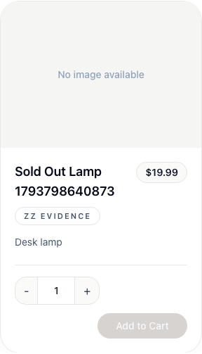
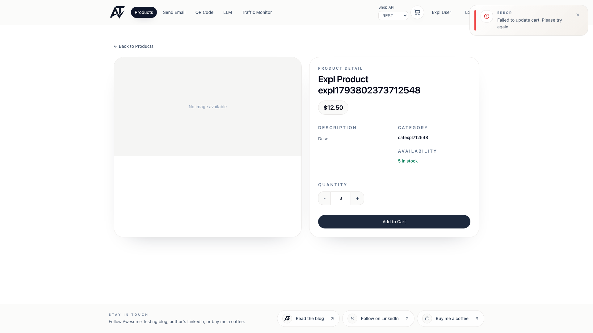

# BUG-005 [USABILITY] Usability findings on Login, Register, Products and Product details

| | |
|---|---|
| Category | Usability |
| Severity / Priority | Minor / P4 |
| Environment | Chromium, all viewports; frontend 3.9.1 |
| Preconditions | Logged out for Login/Register; a fresh client for Products and Product details, extra products created through the admin API |

## Form fields have no `autocomplete` attributes

**Steps:** Inspect the inputs on `/login` and `/register`.

**Expected:** `autocomplete="username"` / `"current-password"` on login; `"username"`, `"email"`, `"new-password"`, `"given-name"`, `"family-name"` on register, so password managers and browsers fill and save credentials reliably.

**Actual:** `autocomplete` is empty on all 7 inputs.

## Login does not trim spaces around the username

**Steps:**
1. Open `/login`.
2. Enter username `  admin  ` (spaces before and after, e.g. pasted) and the correct password.
3. Click "Sign in".

**Expected:** Leading and trailing spaces are ignored and the user is logged in.

**Actual:** Toast "Invalid username/password"; nothing suggests the spaces are the cause.

## Products: out-of-stock product looks available

**Steps:**
1. As admin create a product with `stockQuantity: 0` (`POST /api/v1/products`).
2. As a client open `/products` and find the product.
3. Click "+".

**Expected:** The card says "Out of stock", the quantity controls are disabled or hidden.

**Actual:** The card shows quantity 1 and a greyed "Add to Cart" with no explanation; clicking "+" changes the quantity to 0. Stock is not shown on the list at all (only on `/products/:id`).

## Products: quantity can be decreased to 0

**Steps:** On any product card click "-" while the quantity is 1.

**Expected:** "-" is disabled at 1 (minimum quantity in the API is 1).

**Actual:** Quantity becomes 0 and "Add to Cart" is disabled without a message. For a product already in the cart, at 0 the card shows two "Remove" buttons (`product-remove-button` and `product-add-button` relabelled "Remove").

## Products: filters are lost on refresh

**Steps:**
1. Select category "Books", sort "Price (High to Low)", type "a" in search.
2. Refresh the page.

**Expected:** Filters are kept (e.g. in the URL query), so the view can be refreshed, bookmarked and shared.

**Actual:** URL stays `/products`; after refresh the view returns to "All Products", "Name (A-Z)", empty search. (Back from product details does keep the category.)

## Products: prices have no thousands separator

**Steps:** Look at the MacBook Pro 14 price.

**Expected:** `$1,999.99` (en-US formatting).

**Actual:** `$1999.99`; a product priced 99999999.99 shows `$99999999.99`.

## Products: search is diacritics-sensitive

**Steps:** With a product named "Zażółć…", search for `zazolc`.

**Expected:** The product is found (users often type without Polish characters).

**Actual:** No results; only `zażółć` / `ZAŻÓŁĆ` match.

## Product details: quantity can be decreased to 0

**Steps:**
1. Open `/products/:id` for a product with stock.
2. Click "-" while the quantity is 1.

**Expected:** "-" is disabled at 1, as the API minimum is 1.

**Actual:** Quantity becomes 0 and "Add to Cart" is disabled without a message. For a product already in the cart, clicking "Update Cart" at 0 removes it (toast "Removed from cart"), so "Update" silently acts as "Remove". Same as on the `/products` cards.

## Product details: stock conflict shows a generic error and stale stock

**Steps:**
1. Open `/products/:id` for a product with stock 5 and set the quantity to 3.
2. As admin lower the stock to 2 (`PUT /api/v1/products/:id`).
3. Click "Add to Cart".

**Expected:** A message that says why, e.g. "Only 2 left in stock", and the availability and the quantity limit refreshed.

**Actual:** Toast "Error / Failed to update cart. Please try again." although the API answers 409 `{"message": "Insufficient stock for product <id>"}`; the page still says "5 in stock" and allows 5, so trying again fails the same way. A deleted product (404) gets the same toast.

## Product details: missing product is reported as a loading error

**Steps:** Open `/products/<id of a deleted product>` (e.g. `/products/999999999`).

**Expected:** "Product not found" (it may have been removed), with a link to the list.

**Actual:** "Error loading product details", which suggests a temporary failure worth retrying; the API answer is a plain 404.

## Product details: going back to the list resets the category

**Steps:**
1. On `/products` select a category and click a product name.
2. On the details page click "← Back to Products" (or the browser Back button).

**Expected:** The list opens with the previously selected category.

**Actual:** The list opens with "All Products" (reproduced 3 times with both the link and browser Back, frontend 3.9.1); the user has to find the category again. This contradicts the remark in "Products: filters are lost on refresh" that Back keeps the category.

## Product details: deep link is lost after login

**Steps:**
1. Logged out, open `/products/<id>` (e.g. a shared link).
2. The app redirects to `/login`; log in.

**Expected:** The user lands on `/products/<id>`.

**Actual:** The user lands on `/` and has to find the product again.

