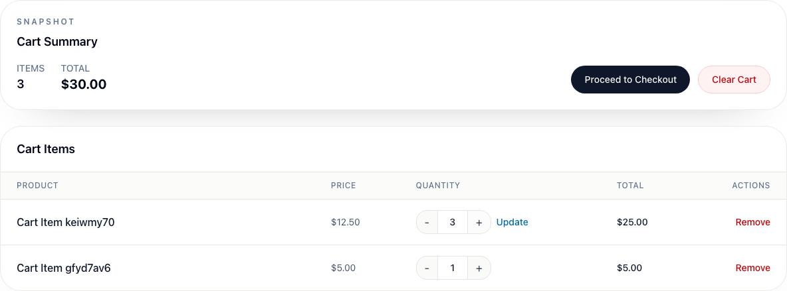
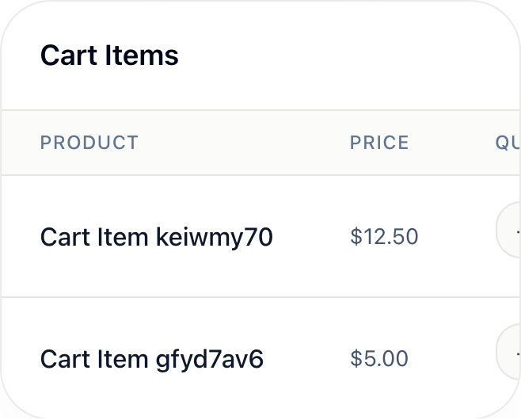

# BUG-005 [USABILITY] Usability findings on Login, Register and Products

| | |
|---|---|
| Category | Usability |
| Severity / Priority | Minor / P4 |
| Environment | Chromium, all viewports; frontend 3.9.1 |
| Preconditions | Logged out for Login/Register; a fresh client for Products, extra products created through the admin API |

## Form fields have no `autocomplete` attributes

**Steps:** Inspect the inputs on `/login` and `/register`.

**Expected:** `autocomplete="username"` / `"current-password"` on login; `"username"`, `"email"`, `"new-password"`, `"given-name"`, `"family-name"` on register, so password managers and browsers fill and save credentials reliably.

**Actual:** `autocomplete` is empty on all 7 inputs.

## Login does not trim spaces around the username

**Steps:**
1. Open `/login`.
2. Enter username `  admin  ` (spaces before and after, e.g. pasted) and the correct password.
3. Click "Sign in".

**Expected:** Leading and trailing spaces are ignored and the user is logged in.

**Actual:** Toast "Invalid username/password"; nothing suggests the spaces are the cause.

## Products: out-of-stock product looks available

**Steps:**
1. As admin create a product with `stockQuantity: 0` (`POST /api/v1/products`).
2. As a client open `/products` and find the product.
3. Click "+".

**Expected:** The card says "Out of stock", the quantity controls are disabled or hidden.

**Actual:** The card shows quantity 1 and a greyed "Add to Cart" with no explanation; clicking "+" changes the quantity to 0. Stock is not shown on the list at all (only on `/products/:id`).

## Products: quantity can be decreased to 0

**Steps:** On any product card click "-" while the quantity is 1.

**Expected:** "-" is disabled at 1 (minimum quantity in the API is 1).

**Actual:** Quantity becomes 0 and "Add to Cart" is disabled without a message. For a product already in the cart, at 0 the card shows two "Remove" buttons (`product-remove-button` and `product-add-button` relabelled "Remove").

## Products: filters are lost on refresh

**Steps:**
1. Select category "Books", sort "Price (High to Low)", type "a" in search.
2. Refresh the page.

**Expected:** Filters are kept (e.g. in the URL query), so the view can be refreshed, bookmarked and shared.

**Actual:** URL stays `/products`; after refresh the view returns to "All Products", "Name (A-Z)", empty search. (Back from product details does keep the category.)

## Products: prices have no thousands separator

**Steps:** Look at the MacBook Pro 14 price.

**Expected:** `$1,999.99` (en-US formatting).

**Actual:** `$1999.99`; a product priced 99999999.99 shows `$99999999.99`.

## Products: search is diacritics-sensitive

**Steps:** With a product named "Zażółć…", search for `zazolc`.

**Expected:** The product is found (users often type without Polish characters).

**Actual:** No results; only `zażółć` / `ZAŻÓŁĆ` match.

## Cart: a changed quantity is silently discarded on "Proceed to Checkout"

**Steps:**
1. With 2 pieces of a $12.50 product in the cart, open `/cart`.
2. Click "+" (quantity shows 3 and an "Update" link appears).
3. Click "Proceed to Checkout".

**Expected:** The new quantity is saved automatically, or the user is warned about the unsaved change.

**Actual:** `/checkout` shows quantity 2 and $25.00; the change is lost without a word. Until "Update" is clicked the line total and the summary also keep the old values (quantity 3, line total $25.00), and the small "Update" link is easy to miss.

## Cart: no feedback after Update, Remove or Clear Cart

**Steps:** On `/cart` change a quantity and click "Update", click "Remove", then "Clear Cart" and confirm.

**Expected:** A toast like on `/products` ("Cart updated", "Removed from cart").

**Actual:** No toast for any of the three actions; only the numbers change. The same actions on `/products` show toasts.

## Cart: on mobile and tablet the quantity and Remove columns are off-screen

**Steps:** Open `/cart` with items at 393×852 (and 820×1180).

**Expected:** Rows stack or fit the screen, so quantity and "Remove" are visible.

**Actual:** The table is 1034 px wide inside a horizontally scrollable box. On mobile only Product and Price are visible, on tablet the Actions column is cut off; nothing hints that the table scrolls sideways.

