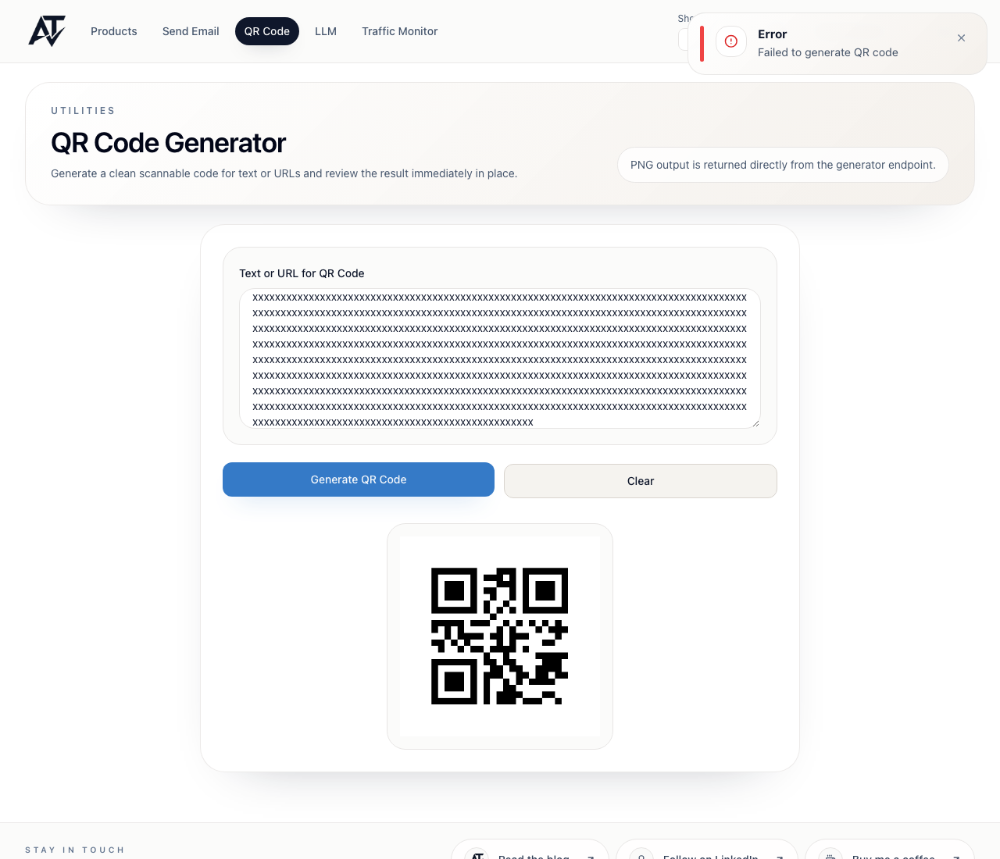

# BUG-010 [FUNCTIONAL] QR code of the previous text stays on screen after a failed generation

| | |
|---|---|
| Category | Functional |
| Severity / Priority | Major / P3 |
| Environment | Chromium (Playwright 1.63), 1920×1080, 820×1180, 393×852; frontend 3.9.1, backend 3.9.4 |
| Preconditions | Logged-in client |

**Steps to reproduce**
1. Open `/qr`, enter `previous text`, click "Generate QR Code" – the code appears.
2. Replace the text with 2954 characters (any text the generator rejects, see BUG-009).
3. Click "Generate QR Code".

**Expected:** The old code is removed (or clearly marked as outdated) when generation for the new text fails.

**Actual:** The toast "Error – Failed to generate QR code" disappears after ~5 s, while the code for `previous text` stays below the new text with no indication that it does not match. Decoding the displayed image gives `previous text`.

**Evidence:**

**Notes:** Impact: a user who misses the toast prints or shares a code with the wrong content. Same happens for any failed request (network error, expired session). Covered by `qr.ui.spec.ts` "should not keep the previous QR code after a failed generation", marked `test.fail()` until fixed – remove the marker after the fix.
