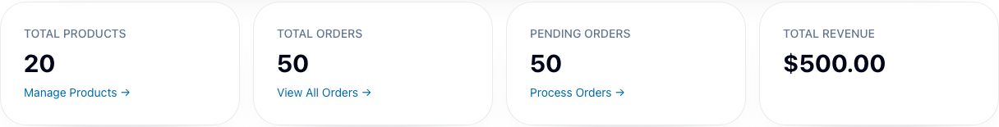

# BUG-011 [FUNCTIONAL] Admin dashboard totals count only the first page of orders

| | |
|---|---|
| Category | Functional |
| Severity / Priority | Major / P2 |
| Environment | localhost:8081, Chromium 153.0.8010.12, 1280×720, frontend 3.9.1, backend 3.9.4 |
| Preconditions | Admin session. A controlled orders response with more than 50 orders. |

**Steps to reproduce**

1. Intercept `GET /api/v1/orders/admin?page=0&size=50` and respond with `totalElements: 51`, `totalPages: 2`, and 50 pending orders at $10 each in `content`.
2. Open `/admin` and compare Total Orders with `totalElements`.
3. Check whether the dashboard requests the second page before displaying Pending Orders and Total Revenue.

**Expected:** Total Orders shows 51. Pending Orders and Total Revenue reflect all orders, or the dashboard labels them as partial.

**Actual:** Total Orders shows 50, Pending Orders shows 50, and Total Revenue shows $500.00. The dashboard makes only the page-0 request.

**Evidence:** Reproduced twice with the same paginated response.

