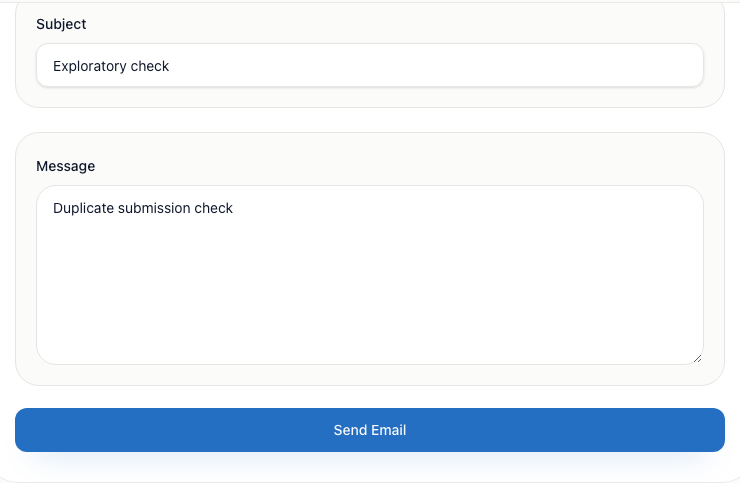

# BUG-012 [FUNCTIONAL] Send Email accepts another submission while the first request is pending

| | |
|---|---|
| Category | Functional |
| Severity / Priority | Major / P2 |
| Environment | localhost:8081, Chromium 153.0.8010.12, 1280×720, frontend 3.9.1, backend 3.9.4 |
| Preconditions | Admin session. Intercept `POST /api/v1/email` and delay each response by two seconds. |

**Steps to reproduce**

1. Open `/email` and fill To with `exploratory@example.invalid`, Subject with `Exploratory check`, and Message with `Duplicate submission check`.
2. Click Send Email and wait until the first POST has started.
3. Click Send Email again before the first response arrives.

**Expected:** The button indicates the request is in progress and a second click creates no additional request.

**Actual:** The button stays enabled with the text “Send Email”. The browser issues two POST requests with the same form values.

**Evidence:** Reproduced twice with intercepted requests.

