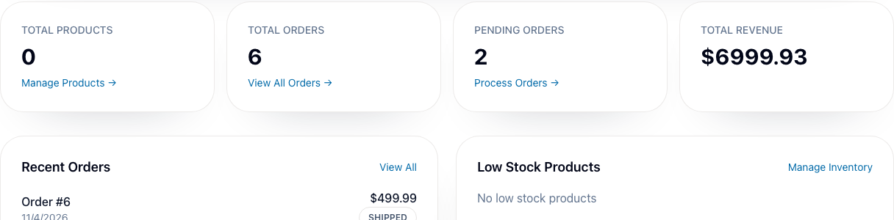
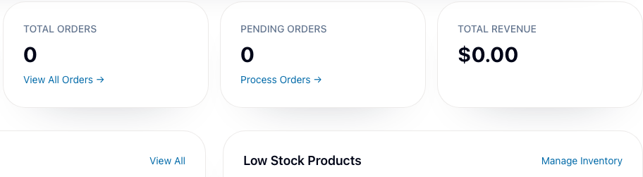

# BUG-013 [FUNCTIONAL] Admin dashboard shows zeros and empty lists when a data request fails

| | |
|---|---|
| Category | Functional |
| Severity / Priority | Major / P2 |
| Environment | localhost:8081, Chromium 153.0.8010.12, desktop, frontend 3.9.1, backend 3.9.4 |
| Preconditions | Admin session. The catalog and orders endpoints return data in the baseline. |

**Steps to reproduce**

1. Intercept `GET /api/v1/products` with HTTP 500, leaving the orders endpoint unchanged. Open `/admin` and let the request settle.
2. Repeat from a fresh browser context with HTTP 500 on `GET /api/v1/orders/admin` instead. Leave the products endpoint unchanged.

**Expected:** The dashboard marks the affected section and metrics as unavailable, explains the failure, and preserves data from the successful request.

**Actual:** In the first case Total Products shows 0 and Low Stock Products shows “No low stock products”. In the second case Total Orders and Pending Orders show 0, Total Revenue shows $0.00, and Recent Orders shows “No orders found”. No visible error or retry option appears in either case.

**Evidence:** Each HTTP 500 scenario was reproduced twice.

