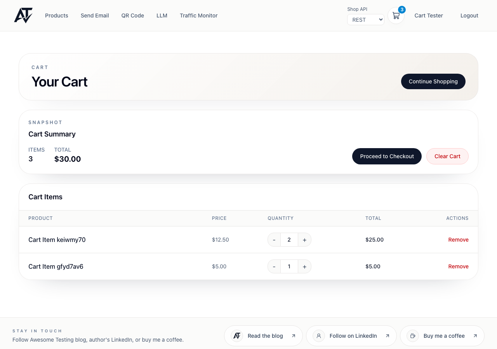

# BUG-cart-1 [FUNCTIONAL] Cart lets the quantity go above stock and silently drops the 409 on "Update"

| | |
|---|---|
| Category | Functional |
| Severity / Priority | Major / P3 |
| Environment | Chromium, 1280×900 (same on all viewports); frontend 3.9.1, backend 3.9.4 |
| Preconditions | Fresh client; a product with `stockQuantity: 3` created through the admin API, 2 pieces in the cart (`POST /api/v1/cart/items`) |

**Steps to reproduce**
1. Open `/cart`.
2. Click "+" in the product row three times.
3. Click "Update".

**Expected:** "+" stops at 3 (as on `/products`, where the quantity is capped by stock); if the API still refuses, an error such as "Only 3 in stock" is shown.

**Actual:** The quantity goes up to 5. "Update" sends `PUT /api/v1/cart/items/:id {"quantity":5}`, the API answers `409 {"message":"Insufficient stock for product :id"}`, the row silently jumps back to 2 and no toast or message appears. The only trace is a console error `Failed to update cart item: AxiosError: Request failed with status code 409`.

**Evidence:**

Before "Update" (stock is 3):

After "Update": quantity back to 2, no message:

**Notes:** Covered by `cart.ui.spec.ts` › "should not allow quantity above available stock" (`test.fail()` until fixed).
