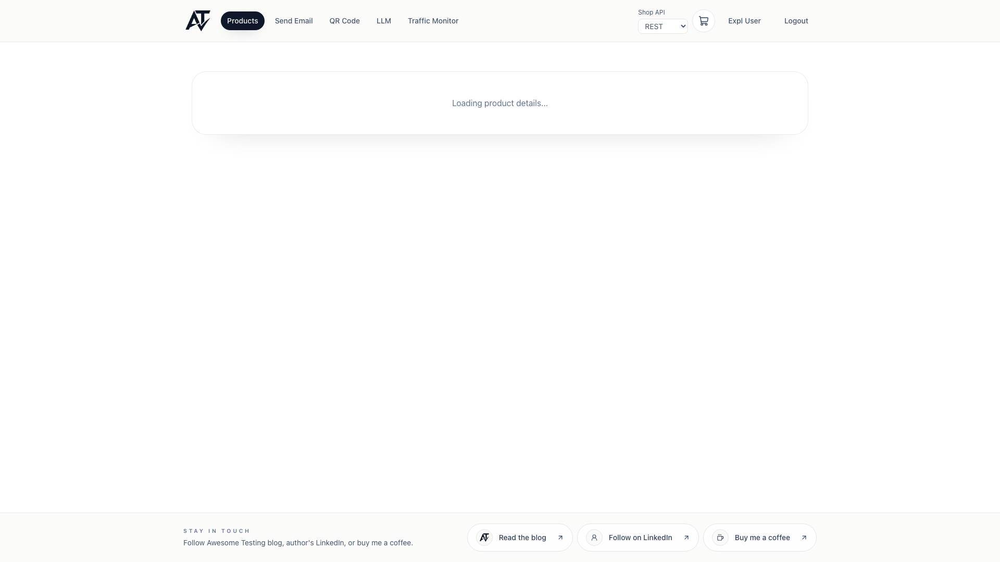
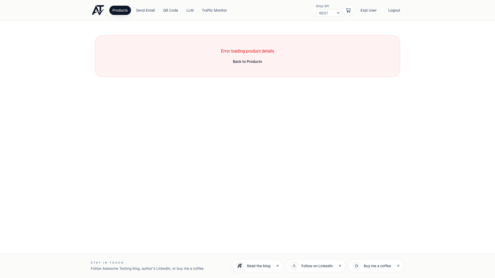

# BUG-pd-1 [FUNCTIONAL] Product details with a non-numeric id request `/api/v1/products/NaN` and load for 7 s

| | |
|---|---|
| Category | Functional |
| Severity / Priority | Minor / P4 |
| Environment | Chromium, 1920×1080; frontend 3.9.1, backend 3.9.4 |
| Preconditions | Logged in as a fresh client |

**Steps to reproduce**
1. Open `/products/abc` (same with `/products/1.5`).
2. Watch the page and the network tab.

**Expected:** The id is validated on the client (or the 400 is not retried): "product not found" is shown at once, as for a numeric id that does not exist (`/products/999999999` → 404 → error box after ~60 ms).

**Actual:** The frontend sends `GET /api/v1/products/NaN` (for `1.5`: `/api/v1/products/1.5`), gets 400 and retries it 3 more times (4 requests in total). For about 7.3 s the page shows "Loading product details..." (`product-loading`), only then "Error loading product details" (`product-not-found`). Reproduced 3 times (7357 ms, 7341 ms, 7380 ms). The console logs 4× "Failed to load resource: the server responded with a status of 400".

**Evidence:**

**Notes:** Suspected cause: the route param is passed through `Number()` without a check, and the query client retries every failed request except 404. Impact is small (only hand-edited or broken links), but the request with `NaN` shows the id is never validated.
