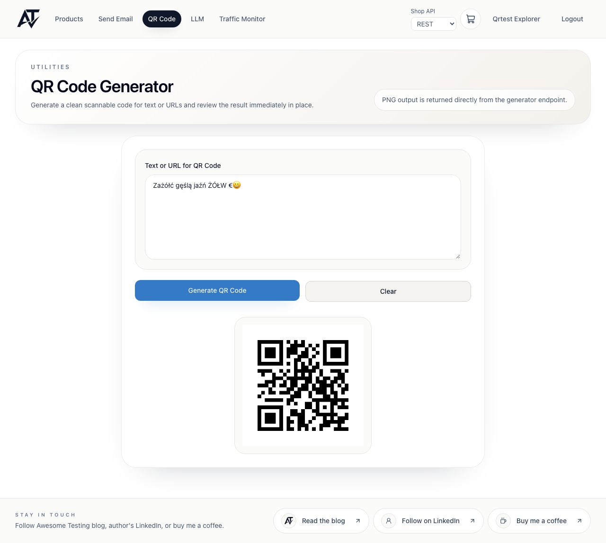

# BUG-qr-1 [FUNCTIONAL] QR code replaces Polish diacritics and emoji with "?"

<!-- Working number; the final BUG-NNN and file name are assigned at merge. Suggested slug: functional-qr-non-latin1-characters-lost -->

| | |
|---|---|
| Category | Functional |
| Severity / Priority | Major / P2 |
| Environment | Chromium (Playwright 1.63), 1920×1080, 820×1180, 393×852; frontend 3.9.1, backend 3.9.4 |
| Preconditions | Logged-in client (fresh user from `POST /api/v1/users/signup`) |

**Steps to reproduce**
1. Open `/qr`.
2. Enter `Zażółć gęślą jaźń ŻÓŁW €😀` and click "Generate QR Code".
3. Scan the displayed code (phone camera, or Chromium `BarcodeDetector` on the `qr-code-image` element).

**Expected:** The code decodes to exactly the entered text, `Zażółć gęślą jaźń ŻÓŁW €😀`.

**Actual:** It decodes to `Za?ó?? g??l? ja?? ?Ó?W ??`. Only characters that exist in ISO-8859-1 (`ó`, `Ó`) survive; `ż ł ć ę ś ą ź ń Ż Ł €` and emoji become `?`.

**Evidence:**
- The frontend sends the text correctly: request `POST /api/v1/qr/create` body `{"text":"Zażółć gęślą jaźń ŻÓŁW €😀"}`.
- The API alone reproduces it: `POST /api/v1/qr/create` with `{"text":"żółw"}` (`Content-Type: application/json; charset=utf-8`) → 200, PNG decodes to `?ó?w`.
- Capacity matches Latin-1 bytes: 2953 characters is the maximum (see BUG-qr-2), the byte-mode limit of a version 40-L code.

**Notes:** Suspected cause: the backend encoder (ZXing) uses its default ISO-8859-1 character set; set `EncodeHintType.CHARACTER_SET` to `UTF-8` (and ECI). Impact: any non-Latin text (Polish, Cyrillic, CJK, emoji) produces a code with a different, corrupted content and the user cannot tell from the screen. Regression test belongs at API level with a QR decoder; the UI test `qr.ui.spec.ts` only checks that the text is sent unchanged.
