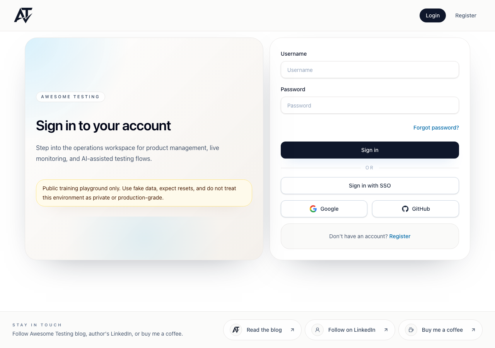

# BUG-0016: Login alternative sign-in separator has insufficient contrast

| Jira field / metadata | Value |
| --- | --- |
| Summary | [UI] Login “or” separator has insufficient text contrast |
| Issue Type | Bug |
| Priority | To be determined |
| Component/s | Login, accessibility |
| Labels | ui, accessibility, visual, login |
| Environment | Local gateway `http://localhost:8081`, frontend image 3.9.1, SSO enabled |
| Browser / viewport | Playwright Chromium, 1280 × 720 (automated scan); screenshot 1280 × 900 |
| Source revision | Runtime image revision not established |
| Verification date | 2026-10-27 |
| Report status | New |
| Jira | — |

## Description

The “or” text separating password sign-in from alternative sign-in methods is
low contrast and can be difficult to read. Normal text should meet the 4.5:1
minimum in [WCAG 2.2 contrast minimum](https://www.w3.org/TR/WCAG22/#contrast-minimum).

## Steps to reproduce

1. Open `/login` on the local stack with SSO enabled.
2. Inspect the “or” label between the sign-in and SSO buttons or run `npm run test:a11y`.

## Expected result

The label has a contrast ratio of at least 4.5:1 against its background.

## Actual result

Axe's `color-contrast` rule reports 2.63:1 for the label.

## Evidence

The screenshot shows the label in context; it does not establish the numerical
contrast ratio. `@axe-core/playwright` reported foreground `#90a1b9` against
`#ffffff`, 12 px normal text, ratio 2.63:1, expected 4.5:1, on
`[data-testid="login-sso-divider-label"]`. It reported the same finding both on
the initial page and after empty-form validation. See the separate
[accessibility scan](../../tests/accessibility/login.a11y.spec.ts).

## Root cause

Not established for the deployed image.

## Acceptance criteria

- The label remains readable and meets at least 4.5:1 contrast against its background.
- The affected accessibility scans pass without suppressing this finding.
