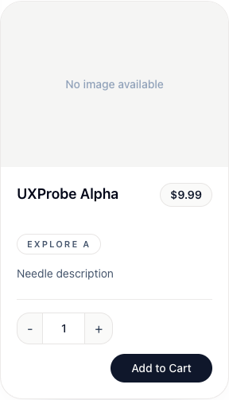

# BUG-0021: Missing-image text has insufficient contrast

| Jira field / metadata | Value |
| --- | --- |
| Summary | [Products] Missing-image text has insufficient contrast |
| Issue Type | Bug |
| Priority | Medium |
| Component/s | Product catalog |
| Labels | ui, accessibility, visual, products |
| Environment | http://localhost:8081/products; frontend 3.9.1; backend 3.9.4; disposable client and owned products |
| Browser / viewport | Chromium; 1920 × 1080 unless otherwise stated |
| Source revision | Deployed frontend image label: 607fe6be7f3be33ed2e7f47d78957b18b63cb81b; relevant files identical at local 7392a3a935b373f3160c5a3ae4162c5b2f310624 |
| Verification date | 2026-10-28 |
| Report status | New |
| Jira | Not created |

## Description

The “No image available” text is difficult to read against its background. The normal 14 px text fails the 4.5:1 contrast requirement (WCAG 2.2, 1.4.3 Contrast Minimum).

## Steps to reproduce

1. Create an owned product with an empty image URL and open `/products` as a client.
2. Find its missing-image placeholder.
3. Inspect the colors or run axe on the products content.

## Expected result

Normal-size placeholder text has at least 4.5:1 contrast against its rendered background.

## Actual result

The placeholder renders foreground `#90a1b9` on background `#f5f5f4`, approximately 2.41:1.

## Evidence

A runtime axe scan scoped to `main`, with WCAG 2 A/AA and 2.1 A/AA tags, reported `color-contrast` (serious) on all four owned missing-image placeholders. The failure identifies normal 14 px text and a 2.41 ratio. The placeholders were also visible in phone/tablet/desktop screenshots; the measured axe result is from desktop.

The screenshot shows one disposable product and the faint placeholder text.

## Root cause

[ProductCard.tsx](https://github.com/slawekradzyminski/vite-react-frontend/blob/607fe6be7f3be33ed2e7f47d78957b18b63cb81b/src/components/products/ProductCard.tsx#L143) uses `text-slate-400` over `bg-stone-100`. This is separate from the existing login divider contrast issue, which has a different component and style.

## Acceptance criteria

- Placeholder text meets 4.5:1 contrast in supported themes/backgrounds.
- Repeat the focused contrast scan and retain a regression with the style fix.
