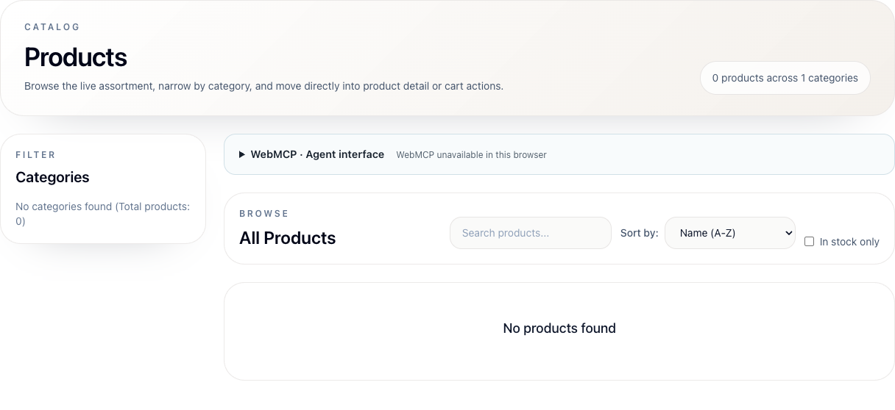

# BUG-0024: Catalog summary reports one category when there are none

| Jira field / metadata | Value |
| --- | --- |
| Summary | [Products] Catalog summary reports one category when there are none |
| Issue Type | Bug |
| Priority | Low |
| Component/s | Product catalog |
| Labels | ui, functional, usability, products |
| Environment | http://localhost:8081/products; frontend 3.9.1; backend 3.9.4; disposable client and owned products |
| Browser / viewport | Chromium; 1920 × 1080 unless otherwise stated |
| Source revision | Deployed frontend image label: 607fe6be7f3be33ed2e7f47d78957b18b63cb81b; relevant files identical at local 7392a3a935b373f3160c5a3ae4162c5b2f310624 |
| Verification date | 2026-10-28 |
| Report status | New |
| Jira | Not created |

## Description

The catalog summary invents a category for an empty catalog and displays the same unsupported totals during initial loading and load failure. Users receive contradictory information about available data.

## Steps to reproduce

1. Intercept browser `GET /api/v1/products` and return HTTP 200 with `[]`.
2. Reload `/products` and compare the summary with the categories and product empty states.
3. Separately delay the initial request, then return HTTP 500 through the query retry cycle.

## Expected result

An empty successful result reports zero products and zero categories. Loading/error states do not present unknown totals as established catalog data.

## Actual result

The summary reads “0 products across 1 categories”. At the same time the category panel says “No categories found (Total products: 0)”. The same summary appears during loading and after the injected catalog failure.

## Evidence

All three states were observed with browser-only response control; the server catalog was not emptied. Removing interception and reloading recovered the real 12-product catalog, including four owned products.

The screenshot shows the contradictory category counts.

## Root cause

[productsPage.tsx](https://github.com/slawekradzyminski/vite-react-frontend/blob/607fe6be7f3be33ed2e7f47d78957b18b63cb81b/src/pages/products/productsPage.tsx#L42) renders `categories.length || 1`. The summary is unconditional, while unavailable product data defaults to an empty array.

## Acceptance criteria

- An empty catalog reports zero categories with suitable wording.
- Loading/error states suppress totals or clearly mark them unavailable.
- Add focused regressions for successful empty data and unavailable data.
